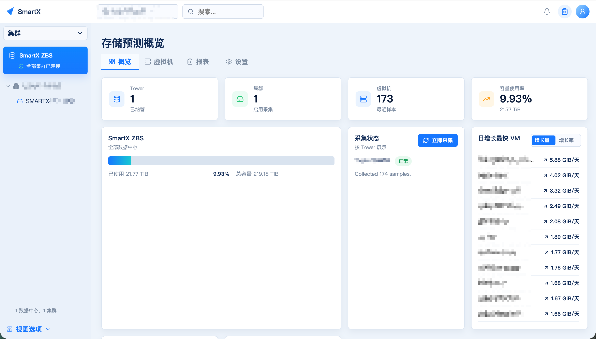
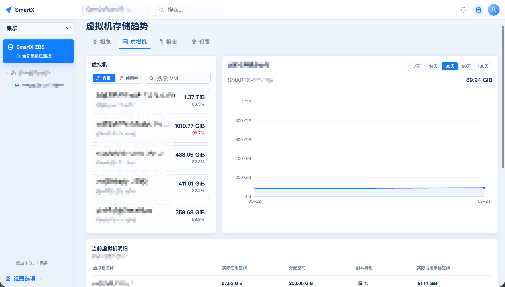
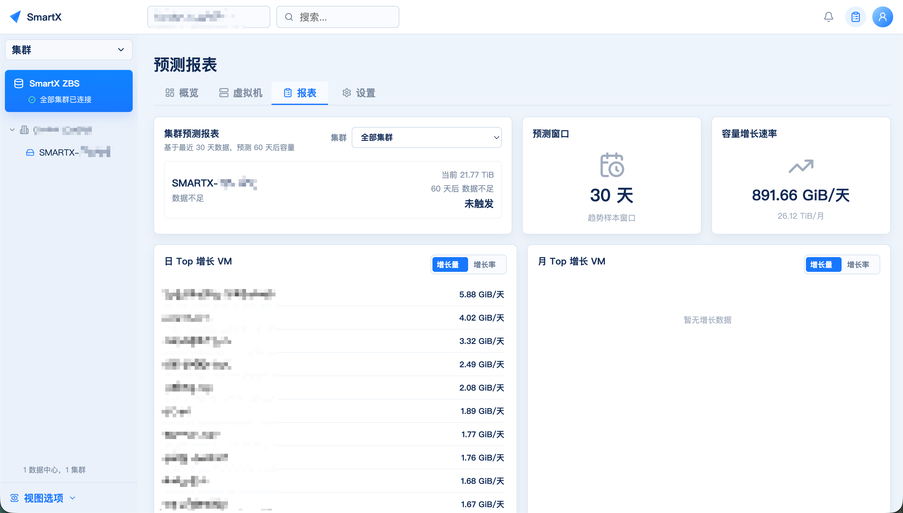
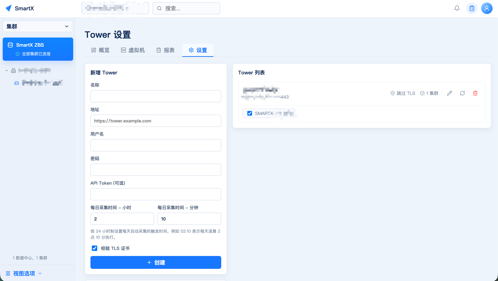

# SmartX HCI Capacity Insight

[简体中文](README.zh-CN.md) | English

Version: `v0.5.4`

> Status: This project is in the testing stage. Validate it in your environment before production use.

SmartX HCI Capacity Insight is a storage capacity monitoring and forecasting platform for SmartX hyperconverged infrastructure. It collects read-only capacity data from CloudTower/Tower datacenters, clusters, virtual machines, and virtual volumes, and provides capacity overviews, VM storage trends, top-growing VM rankings, and cluster forecast reports.

> This project was developed with AI assistance.

## Features

- Multi-Tower and multi-cluster capacity overview.
- Scheduled and manual collection.
- VM storage trends for 7, 14, 30, 90, 180, and 365 days, with current and all VM volume details.
- Daily and monthly top-growing VM rankings, sortable by growth amount or growth ratio.
- Cluster forecast reports with linked capacity trend charts.
- Word and Excel report export for all clusters, one Tower, or one cluster, with selectable 7, 14, 30, 90, 180, and 365 day windows.
- Data quality notes in reports and exports: actual collection window, missing days, sample sufficiency, and incomplete clusters.
- Tower-level collection status with read-only CloudTower integration.

## Screenshots

### Dashboard Overview



### VM Storage Trend



### Forecast Report



### Tower Settings



## Architecture

```text
CloudTower/Tower
      |
      v
collector-worker ----> SQLite (/data/smartx.db)
      |                    |
      v                    v
Prometheus <---------- web-api (FastAPI)
                           |
                           v
frontend (React + TypeScript + ECharts)
```

The platform runs five containers: `web-api`, `collector-worker`, `frontend`, `prometheus`, and `upgrade-runner`. Their roles, ports, and data directories are listed in the [Deployment Guide](docs/deployment.md).

## Quick Start

There is **a single install entry point: `install.sh`** (it auto-detects the source shape and the online/offline mode). Pick your scenario:

| Scenario | What to do |
| --- | --- |
| **Internet-connected server**, install from source | `git clone` this repo → run `sudo bash install.sh --yes` from the repo root (online mode: images are pulled) |
| **Offline server** with a delivery bundle | Verify the bundle SHA256, `tar -xzf smartx-capacity-insight-v0.5.4-offline.tar.gz` → inside the bundle run `sudo bash install/install.sh --yes` (offline mode: images are included) |
| **Only image tars**, no bundle | Put the image tars next to this repo → `sudo bash install.sh --mode offline --images <tar dir> --yes`. The tars must cover the tags compose declares: `web-api`/`collector-worker`/`frontend` `v0.5.4`, `upgrade-runner` `v0.3.2`, `prom/prometheus` `v2.55.1` |

Then open `http://<server-ip>:8080`, log in with `admin` / `password`, and change the password immediately.

Ports: Web UI `8080`, API `8000`, Prometheus `9090`.

See the [Deployment Guide](docs/deployment.md) for requirements, image details, and verification steps, and the [offline delivery README](delivery/README.md) for the bundle contents and upgrades.

For development, build and run the stack from source (development only, not for deployment):

```bash
cp .env.example .env
# set SMARTX_SECRET_KEY, SMARTX_CREDENTIAL_KEY, and SMARTX_ADMIN_PASSWORD
sudo ./pre_install.sh
docker compose -f docker-compose.dev.yml up -d --build
```

## Upgrade

Use the offline delivery bundle's `upgrade/upgrade.sh`. Do not load images or restart services manually.

The v0.5.4 procedure has two steps and the order is fixed: **upgrade the runner component first, then the platform**. See the [offline delivery README](delivery/README.md) for the complete procedure and supported source versions.

## Documentation

- [Deployment Guide](docs/deployment.md) / [部署指南](docs/deployment.zh-CN.md)
- [Operations Scripts](ops/README.md) — dev-side `install.sh` wrapper, `upgrade.sh`, `package.sh`
- [Offline Delivery README](delivery/README.md) — install, upgrade, self-check, and common failures
- [Usage Guide](docs/usage.md)
- [API Reference](docs/api.md)
- [Troubleshooting](docs/troubleshooting.md)
- [Backup & Recovery](docs/backup-recovery.md) — backup inventory, restore procedure, and red lines
- [OVA Delivery](docs/ova-delivery.md)
- [Changelog](docs/releases/CHANGELOG.md)
- [upgrade-runner Lifecycle](docs/upgrade-runner-lifecycle.md)

Data migration packages and their recovery key (`.env`) must be stored together. Without the key, encrypted Tower credentials cannot be recovered. See the Usage Guide, section 11.

## CloudTower Compatibility and Permissions

- Use a read-only CloudTower account or a read-only API token.
- The CloudTower instance must provide these v2 HTTP API endpoints:

```text
POST /v2/api/login
GET  /v2/api/get-version
POST /v2/api/get-clusters
POST /v2/api/get-cluster-storage-info
POST /v2/api/get-vms
POST /v2/api/get-vm-volumes
```

- CloudTower/Tower 4.4.0 or later is required. CloudTower 4.4.x does not provide `get-cluster-storage-info`; the platform falls back to capacity fields from `get-clusters`.

## Password Reset

On the target server:

```bash
cd /data/smartx-storage-forecast/project
docker compose exec web-api python -m app.cli reset-password --username admin
```

For a non-interactive reset, add `--password <new-password>`. Then log in again with the new password.

## Security Notes

- Keep `.env`, SQLite databases, Prometheus data, backups, exports, and Tower credentials out of Git.
- Use read-only CloudTower credentials.
- Restrict access to ports `8000`, `8080`, and `9090` in production networks.
- Replace the default secrets and administrator password before production use.

## Development

```text
backend/       FastAPI API, collector, CloudTower client, forecast logic, CLI
frontend/      React + TypeScript frontend
prometheus/    Prometheus scrape configuration
install.sh     Unified install entry point (online/offline auto-detection)
ops/           Dev-side packaging and operations entry points
scripts/       Build and verification tooling
delivery/      Source files for the offline delivery bundle
docs/          Deployment, usage, API, and operations documentation
```

Run the tests:

```bash
cd backend && pytest
```

```bash
cd frontend && npm test
```

## License

MIT License.
